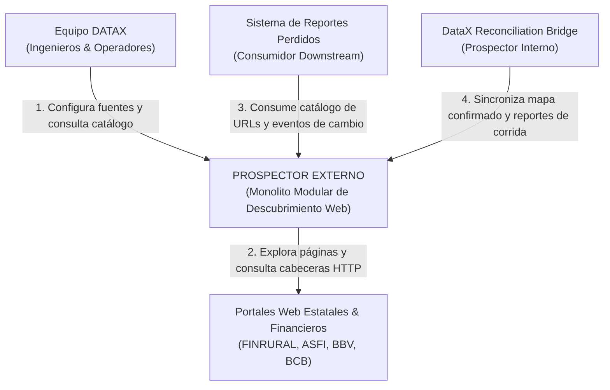
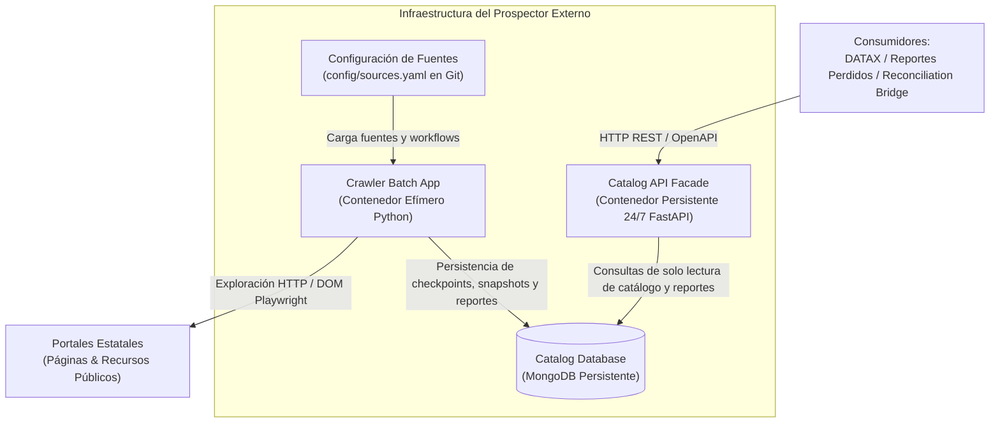
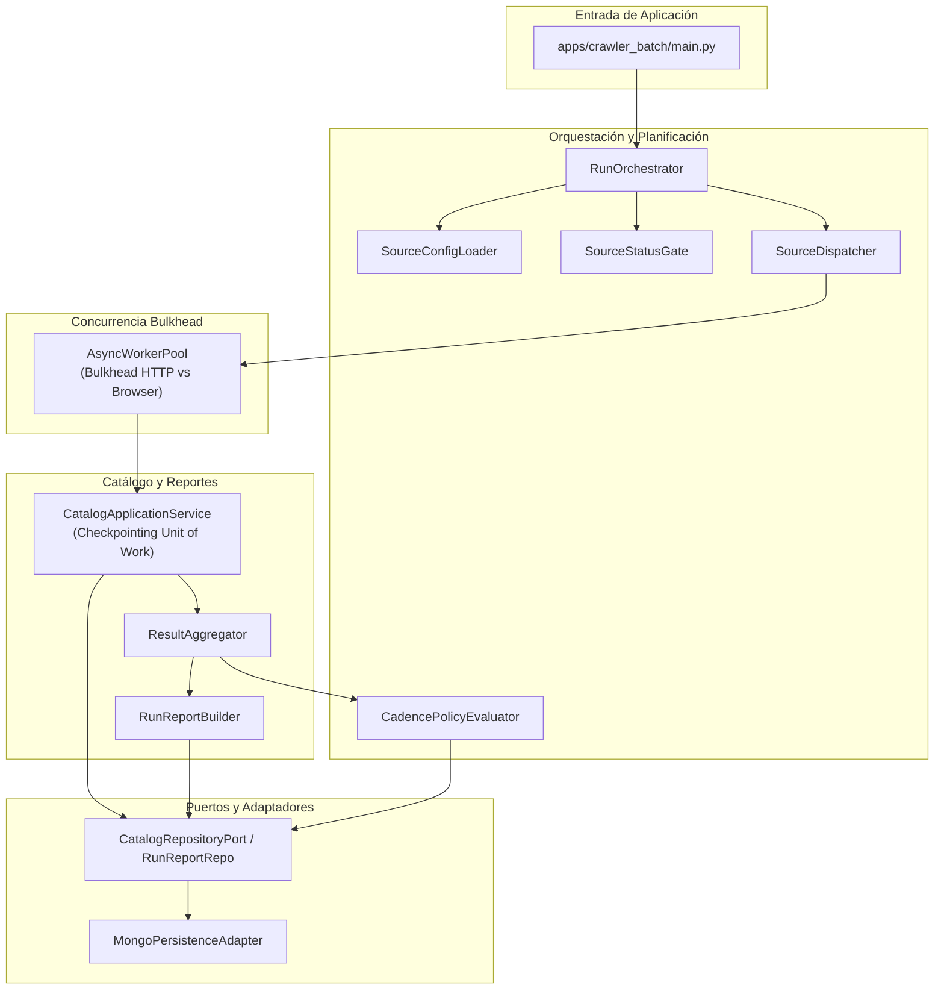
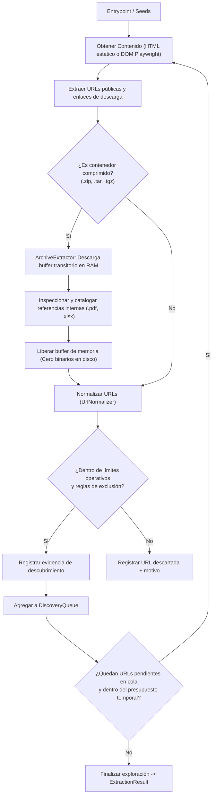
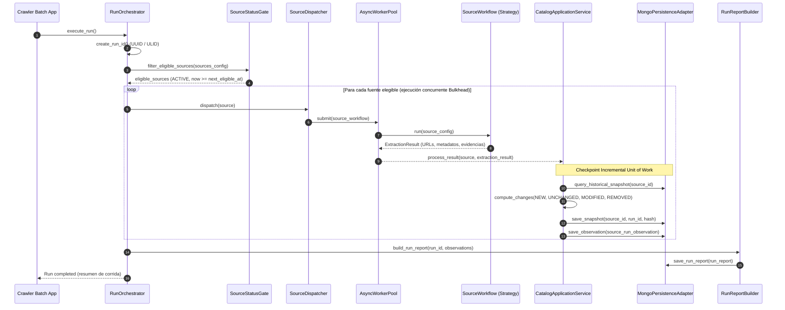
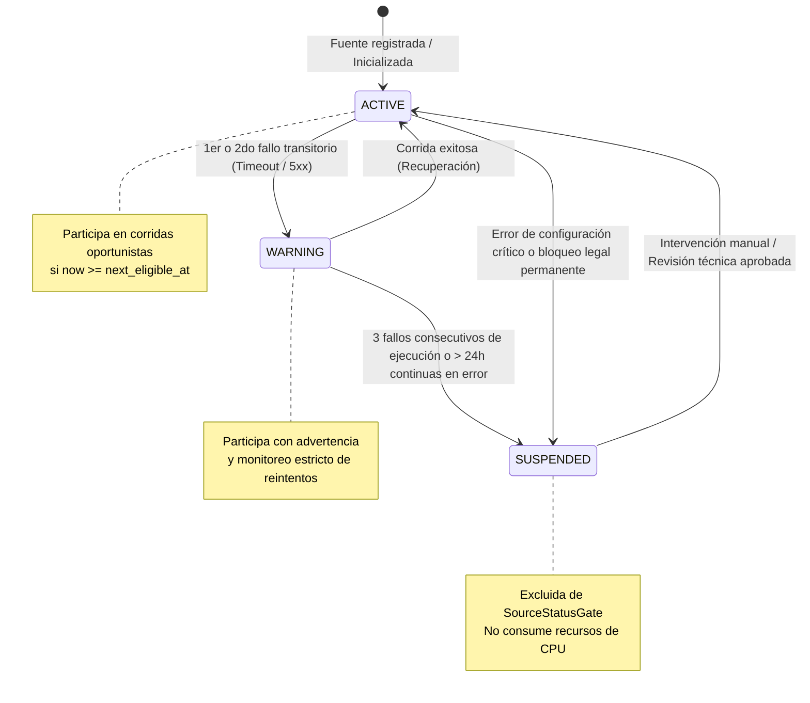

# Documento de Arquitectura — Prospector Externo

**Estado:** Propuesta técnica consolidada para revisión y aprobación

**Sistema:** Prospector Externo de DATAX

**Formato:** Markdown técnico

**Alcance de esta versión:** Descubrimiento exhaustivo de URLs y recursos públicos de fuentes estatales, almacenamiento de inventario bruto, trazabilidad por corrida, estado operativo de fuentes, reportes estructurados y API de consulta.

---

## 1. Resumen ejecutivo

El **Prospector Externo** es un sistema independiente encargado de explorar fuentes estatales públicas, recorrer su contenido accesible, descubrir URLs de páginas y recursos, y producir un inventario bruto que pueda ser consultado por DATAX y por el sistema de Reportes Perdidos.

El objetivo del sistema no es decidir si un recurso es relevante, limpio, confiable semánticamente ni útil para una consulta de negocio. Su responsabilidad es maximizar la cobertura de descubrimiento dentro del alcance técnico permitido, registrar evidencia del recorrido y exponer resultados trazables. El filtrado, limpieza, indexación semántica, selección de URLs de respaldo y demás decisiones posteriores pertenecen a otras etapas o sistemas.

La propuesta adopta un **monolito modular** en Python con estilo de **Arquitectura Hexagonal (Ports and Adapters)**. El sistema se despliega en dos contenedores: un proceso batch efímero para la exploración y un servicio HTTP persistente para consultar el catálogo y los reportes. El núcleo de descubrimiento utiliza workflows especializados seleccionados manualmente por fuente en una configuración YAML versionada, evitando tanto un crawler universal complejo como la proliferación de clases por fuente.

El backlog original define cinco fuentes iniciales, generación de JSON sin descarga de binarios, catálogo con hashes y trazabilidad, API de solo lectura y detección de fallos persistentes.[file:107] Esta propuesta conserva esos objetivos y sustituye los supuestos de “corrida semanal”, notificaciones, correo y Slack por corridas oportunistas con reportes persistidos y consultables.

---

## 2. Problema y objetivos

### 2.1 Problema

Las fuentes estatales publican información con estructuras heterogéneas: HTML estático, contenido renderizado por JavaScript, enlaces incluidos dentro de comentarios HTML, portales apoyados en APIs o flujos atípicos. Además, pueden cambiar su estructura, no publicar novedades durante períodos prolongados o responder de manera intermitente.

Un crawler único, rígido y basado en selectores manuales por cada fuente trasladaría al equipo una carga de mantenimiento alta. A la vez, hacer que múltiples plugins se coordinen de forma dinámica para cada fuente crearía un motor excesivamente complejo para el alcance actual.

### 2.2 Objetivo principal

Construir un sistema que explore de manera exhaustiva el contenido público alcanzable desde los entrypoints configurados, registre todo el inventario bruto de URLs y recursos encontrados, y produzca evidencia clara de cobertura, novedades, ausencia de novedades, fallos y fuentes omitidas.

### 2.3 Objetivos específicos

| Objetivo | Resultado esperado |
|---|---|
| Descubrimiento amplio | Recorrer páginas alcanzables y registrar URLs de páginas y recursos candidatos |
| Adaptación técnica por fuente | Seleccionar un workflow especializado según el reporte técnico proporcionado por DATAX |
| Sin almacenamiento de binarios | Registrar URLs y metadatos disponibles sin almacenar en disco archivos binarios (PDF, XLSX, CSV). Excepción controlada: inspección y descompresión transitoria en memoria de contenedores (`.zip`, `.tar`, `.tgz`) para inventariar sus documentos internos |
| Trazabilidad | Asociar cada resultado, error y observación a `source_id` y `run_id` |
| Resiliencia responsable | Aplicar robots.txt (con override auditable), rate limiting, timeout, retry acotado, fallback HEAD→GET y control de memoria en browser automation |
| Persistencia segura | Realizar checkpoint por fuente terminada para no perder progreso ante una interrupción |
| Claridad operacional | Distinguir una fuente fallida de una fuente que respondió correctamente pero no tenía novedades |
| Consulta externa | Exponer catálogo, observaciones y reportes mediante una API REST de solo lectura |

### 2.4 Fuera de alcance

| Fuera de alcance | Razón |
|---|---|
| Prospector interno de DATAX | Es un sistema independiente, con datos y procesos propios |
| Integración o búsqueda federada entre prospectores | Se analizará en una etapa futura, cuando el Prospector Externo exista y tenga contratos estables |
| Búsqueda semántica o vectorial | No pertenece al objetivo de inventario bruto |
| Filtrado de negocio y limpieza de resultados | Corresponde a etapas posteriores y a otros equipos |
| Selección de URLs de respaldo | Responsabilidad del sistema Reportes Perdidos |
| Almacenamiento y análisis persistente de contenido binario | El sistema registra referencias; no almacena binarios en disco (salvo inspección transitoria en memoria de comprimidos) |
| Slack, correo y notificaciones push | No son parte de esta propuesta; el sistema persiste y expone reportes consultables |
| Composición automática de plugins | Se reemplaza por workflows especializados seleccionados manualmente |

---

## 3. Principios de arquitectura

| Principio | Decisión aplicada |
|---|---|
| Separación de responsabilidades | Exploración, persistencia, planificación, agregación de métricas, generación de reportes y consulta API tienen componentes distintos |
| Dependencias hacia adentro | El dominio y los casos de uso no dependen de MongoDB, requests, Playwright, FastAPI ni de sitios externos |
| Configuración sobre modificación | DATAX selecciona el workflow de una fuente en YAML; el core no se modifica por esa decisión |
| Extensibilidad controlada | Se agregan workflows nuevos cuando aparece un tipo de fuente real que no encaja en los existentes |
| Datos brutos primero | El crawler registra lo descubierto; no impone filtros semánticos ni de negocio |
| Estado explícito | La salud, planificación, observaciones y reportes se almacenan como información consultable y auditable |
| Una fuente de verdad | `CatalogApplicationService` centraliza la actualización de snapshots y observaciones; `CadencePolicyEvaluator` centraliza las decisiones de planificación |
| Resiliencia proporcional | Se protegen las fuentes con mecanismos simples y verificables, sin incorporar mecanismos distribuidos innecesarios |
| Diseño para auditoría | Todo resultado relevante conserva `run_id`, `source_id`, timestamps, workflow y motivo de error u omisión |

---

## 4. Estilo arquitectónico

### 4.1 Estilo principal: Monolito modular

Se adopta un **monolito modular**: un solo repositorio y una base de datos principal, dividido en módulos con fronteras explícitas. Esto permite entregar el MVP con menor costo operativo que microservicios, manteniendo la capacidad de separar módulos posteriormente si la carga, el equipo o la evolución del dominio lo justifican.

El sistema contiene dos procesos desplegables, pero ambos pertenecen al mismo producto y comparten contratos internos y persistencia:

| Contenedor | Tecnología propuesta | Ciclo de vida | Responsabilidad |
|---|---|---|---|
| `Crawler Batch App` | Python | Efímero; se ejecuta cuando existe una corrida seleccionada | Explora fuentes, persiste resultados, actualiza observaciones y genera reportes de corrida |
| `Catalog API Facade` | FastAPI/Python | Persistente, 24/7 | Expone consultas simples de catálogo, observaciones y reportes |
| `Catalog Database` | MongoDB | Persistente | Almacena inventario, snapshots, estado, observaciones, planificación y reportes |
| Configuración de fuentes | YAML versionado | Cargada por el batch | Declara fuente, entrypoint y workflow |

### 4.2 Estilo interno: Arquitectura Hexagonal

Cada módulo relevante respeta Ports and Adapters:

```text
Dominio / aplicación
    -> define puertos y contratos

Adaptadores entrantes
    -> batch entrypoint
    -> controladores HTTP FastAPI

Adaptadores salientes
    -> MongoDB
    -> cliente HTTP
    -> Playwright
    -> lectura YAML
```

El propósito es que las decisiones de negocio y aplicación no dependan de detalles externos. MongoDB puede cambiar, FastAPI puede sustituirse o Playwright puede aislarse sin reescribir la lógica de catálogo, observación y planificación.

### 4.3 Kernel de workflows limitado

El núcleo de exploración usa una variante limitada del patrón **Microkernel / Plugin Architecture**: existe un contrato estable de workflow y un registro que resuelve implementaciones por nombre. No se implementa carga dinámica compleja, marketplace de plugins ni coordinación automática de múltiples plugins.

El kernel mantiene el contrato; los workflows encapsulan las diferencias técnicas.

```text
WorkflowRegistry
    -> HtmlWorkflow
    -> JavascriptWorkflow
    -> CommentedHtmlWorkflow
    -> ApiWorkflow
    -> CustomWorkflow
```

Esta decisión sigue el objetivo de las arquitecturas de plugins: aislar extensiones específicas detrás de un contrato común y evitar modificar el core por cada variación.[web:305][web:308]

---

## 5. Modelo C4 resumido

### 5.1 C1 — Contexto



| Elemento | Rol |
|---|---|
| Equipo DATAX | Define el workflow aplicable a cada fuente y consulta resultados |
| Prospector Externo | Explora fuentes, construye inventario bruto, registra reportes y expone catálogo |
| Fuentes estatales | Portales públicos institucionales explorados por el sistema |
| Sistema Reportes Perdidos | Consumidor externo del catálogo y los reportes publicados |
| DataX Reconciliation Bridge | Sincroniza el inventario externo con el almacenamiento local del Prospector Interno |

### 5.2 C2 — Contenedores



| Contenedor | Tipo | Responsabilidad | Relaciones principales |
|---|---|---|---|
| Crawler Batch App | Aplicación batch Python | Ejecutar corridas oportunistas según fuentes elegibles | Lee YAML, explora fuentes, persiste datos |
| Catalog API Facade | Servicio FastAPI | Consultas REST de catálogo, observaciones y reportes | Lee MongoDB; es consumido por DATAX y Reportes Perdidos |
| Catalog Database | MongoDB | Persistencia del inventario bruto y trazabilidad | Escrito por batch; leído por API |
| Configuración de fuentes | YAML versionado | Declarar `source_id`, `entrypoint` y `workflow` | Mantenida por DATAX; cargada por el batch |

### 5.3 C3 — Componentes del Crawler Batch App

El C3 se divide en dos vistas para evitar mezclar orquestación con detalles del descubrimiento. Un diagrama de componentes describe los bloques estructurales de un único contenedor, sus responsabilidades y dependencias; el comportamiento ordenado de un caso de uso debe documentarse en un diagrama dinámico separado.[web:61][web:48]

#### C3a: Orquestación, catálogo y reportes



| Componente | Módulo | Responsabilidad |
|---|---|---|
| `RunOrchestrator` | Application | Inicia y cierra una corrida; crea `run_id` |
| `SourceConfigLoader` | Application/Config | Lee y valida YAML de fuentes (incluyendo semillas secundarias y overrides) |
| `SourceStatusGate` | Application/Scheduling | Determina qué fuentes participan según estado y planificación |
| `SourceDispatcher` | Application | Crea unidades de trabajo y obtiene el workflow correspondiente |
| `WorkflowRegistry` | Kernel | Resuelve el workflow por nombre |
| `AsyncWorkerPool` | Infrastructure/Concurrency | Ejecuta workflows con concurrencia limitada y throttling estricto de memoria para navegadores |
| `SourceWorkflow` | Kernel/Port | Contrato común: `run(source_config) -> ExtractionResult` |
| `CatalogApplicationService` | Application/Catalog | Compara, realiza checkpoint y produce `SourceRunObservation` |
| `ResultAggregator` | Application/Reporting | Consolida métricas y observaciones de la corrida |
| `RunReportBuilder` | Application/Reporting | Construye el reporte estructurado de corrida |
| `RunReportRepository` | Application/Port | Puerto de persistencia de reportes |
| `CadencePolicyEvaluator` | Application/Scheduling | Actualiza planificación posterior a partir de observaciones |
| `CatalogRepositoryPort` | Application/Port | Puerto de inventario, snapshots, observaciones y estado |
| `MongoPersistenceAdapter` | Adapter/Persistence | Implementa puertos sobre MongoDB |

#### C3b: Descubrimiento por workflow

```mermaid
flowchart TD
    subgraph Kernel ["Microkernel de Workflows"]
        Registry["WorkflowRegistry"]
        WorkflowPort["SourceWorkflow (Puerto)"]
    end

    subgraph Strategies ["Workflows Especializados"]
        HtmlWf["HtmlWorkflow<br/>(Estático - FINRURAL)"]
        CommWf["CommentedHtmlWorkflow<br/>(Comentarios HTML - BBV)"]
        JsWf["JavascriptWorkflow<br/>(Playwright - ASFI)"]
        ApiWf["ApiWorkflow<br/>(Endpoints JSON)"]
        CustomWf["CustomWorkflow<br/>(Casos Atípicos)"]
    end

    subgraph InfraTools ["Infraestructura & Resiliencia"]
        HttpClient["ResilientHttpClient<br/>(Rate Limit, Robots.txt, Fallback HEAD->GET)"]
        PlaywrightDrv["PlaywrightDriver<br/>(Chromium Anti-OOM Throttling)"]
        ArchiveExt["ArchiveExtractor<br/>(Inspección Transitoria en RAM de ZIP/TAR)"]
        Queue["DiscoveryQueue<br/>(URLs pendientes y visitadas)"]
    end

    Registry --> WorkflowPort
    WorkflowPort <|-- HtmlWf
    WorkflowPort <|-- CommWf
    WorkflowPort <|-- JsWf
    WorkflowPort <|-- ApiWf
    WorkflowPort <|-- CustomWf

    HtmlWf --> HttpClient
    HtmlWf --> ArchiveExt
    HtmlWf --> Queue

    CommWf --> HttpClient
    CommWf --> ArchiveExt
    CommWf --> Queue

    JsWf --> PlaywrightDrv
    JsWf --> ArchiveExt
    JsWf --> Queue

    ApiWf --> HttpClient
```

| Componente | Tipo de patrón | Responsabilidad |
|---|---|---|
| `HtmlWorkflow` | Strategy / Workflow | Explora HTML estático y descubre páginas, enlaces y recursos candidatos |
| `JavascriptWorkflow` | Strategy / Workflow | Usa Playwright para explorar contenido dinámico con gestión estricta de memoria RAM |
| `CommentedHtmlWorkflow` | Strategy / Workflow | Inspecciona DOM y comentarios HTML para encontrar referencias ocultas |
| `ApiWorkflow` | Strategy / Workflow | Aplica un flujo de descubrimiento para una fuente basada en API |
| `CustomWorkflow` | Extension / Template Method | Implementa una excepción procedimental real que no encaja en workflows estándar |
| `ArchiveExtractor` | Strategy / Utility | Descomprime e inspecciona en memoria contenedores `.zip`/`.tar` para catalogar sus archivos internos sin persistir binarios |
| `DiscoveryQueue` | Work Queue | Administra URLs pendientes, visitadas, normalizadas y evidencia de descubrimiento |
| `ResilientHttpClient` | Infrastructure Adapter | Ejecuta acceso HTTP protegido con rate limiting y manejo de robots.txt |
| `PlaywrightDriver` | Infrastructure Adapter | Aísla Chromium mediante contextos efímeros, control estricto de concurrencia (máx. 1-2 páginas) y reciclaje de proceso para evitar OOM |
| `ExtractionResult` | Contract / DTO | Devuelve inventario bruto, metadatos observados, cobertura y errores |

---

## 6. Configuración de fuentes

### 6.1 Ubicación

La configuración no vive en MongoDB ni en la API. Debe vivir en el repositorio, versionada junto con el código:

```text
prospector-externo/
├── apps/
│   ├── crawler-batch/
│   └── catalog-api/
├── src/
│   ├── application/
│   ├── domain/
│   ├── kernel/
│   ├── workflows/
│   ├── adapters/
│   └── infrastructure/
├── config/
│   └── sources.yaml
├── tests/
└── docs/
```

### 6.2 Configuración mínima

La configuración por fuente debe ser deliberadamente pequeña pero suficiente para el mundo real. DATAX posee un reporte técnico que indica qué clase de procesamiento corresponde a cada fuente. La configuración selecciona un workflow y permite especificar opcionalmente semillas de subrutas para evitar que el crawler quede atrapado en portadas institucionales saturadas de noticias y contenido irrelevante:

```yaml
sources:
  - source_id: asfi
    entrypoint: https://www.asfi.gob.bo
    workflow: javascript
    seeds:
      - https://www.asfi.gob.bo/index.php/estadisticas/boletines.html

  - source_id: bbv
    entrypoint: https://www.bbv.com.bo
    workflow: commented_html
    seeds:
      - https://www.bbv.com.bo/estadisticas/
      - https://www.bbv.com.bo/acerca-de-la-bolsa/informacion-financiera/

  - source_id: fuente_estatal_restringida
    entrypoint: https://www.ministerio.gob.bo
    workflow: html
    ignore_robots_txt: true
    robots_override_reason: "Mandato legal de auditoría de datos públicos según D.S. NNNN"
```

### 6.3 Campos aprobados

| Campo | Propósito | Responsable |
|---|---|---|
| `source_id` | Identificador estable de la fuente | DATAX / equipo técnico |
| `entrypoint` | URL base oficial desde la cual inicia o se contextualiza el dominio | DATAX / equipo técnico |
| `workflow` | Tipo de crawler especializado que procesará la fuente (`html`, `javascript`, `commented_html`, `api`, `custom`) | DATAX, basado en su reporte técnico |
| `seeds` *(Opcional)* | Lista de URLs de inicio focalizadas (ej. subpáginas `/estadisticas` o `/publicaciones`) para evitar explosión combinatoria en páginas de bienvenida | DATAX / equipo técnico |
| `ignore_robots_txt` *(Opcional)* | Booleano (default: `false`). Habilita bypass ético/legal cuando un portal estatal bloquea bots genéricos indebidamente | DATAX / Legal |
| `robots_override_reason` *(Condicional)* | Justificación obligatoria requerida cuando `ignore_robots_txt: true`, persistida para auditoría | DATAX / Legal |

### 6.4 Campos que no se incluyen ahora

| Campo descartado | Motivo |
|---|---|
| `priority` | No existe un requisito aprobado de priorización de fuentes |
| `enabled` | Duplicaría la responsabilidad de la máquina de salud/estado operativo |
| `run_interval` | La categoría o planificación de ejecución no debe mezclarse con el perfil técnico de exploración |
| `selectors` | El objetivo es descubrimiento amplio, no extracción basada en selectores manuales por fuente |
| `navigation_scripts` | No se escriben scripts de clics o modales específicos; la exploración se maneja por el workflow seleccionado |
| `capabilities` | Obliga a configurar internamente características que ya encapsula el workflow elegido |
| `adaptive_policy` por fuente | Sobredimensiona la configuración; la política común se mantiene como lógica de aplicación |

---

## 7. Workflows de descubrimiento

### 7.1 Selección manual, ejecución encapsulada

Cada fuente tiene un workflow seleccionado manualmente. Esto no significa configurar manualmente cada detalle de la página. Significa elegir, a partir del reporte DATAX, cuál implementación especializada conoce la estrategia de exploración adecuada.

```text
source_config.workflow
    -> WorkflowRegistry.resolve(workflow)
    -> SourceWorkflow.run(source_config)
    -> ExtractionResult
```

### 7.2 Workflows iniciales

| Workflow | Cuándo usarlo | Dependencias técnicas | Responsabilidad |
|---|---|---|---|
| `html` | Portal predominantemente HTML estático | `ResilientHttpClient`, parser HTML, `ArchiveExtractor` | Recorrer y descubrir URLs alcanzables en HTML; inspeccionar comprimidos en memoria |
| `javascript` | Portal cuyo contenido requiere renderizado o interacción JavaScript | `PlaywrightDriver`, parser DOM, `ArchiveExtractor` | Navegar contenido dinámico con control estricto de memoria RAM; descubrir URLs renderizadas |
| `commented_html` | Portal que oculta enlaces o referencias relevantes en comentarios HTML | `ResilientHttpClient`, parser HTML/comentarios, `ArchiveExtractor` | Inspeccionar DOM normal y contenido comentado |
| `api` | Reporte DATAX confirma que la fuente se explora mediante una API | `ResilientHttpClient`, parser JSON | Descubrir URLs y recursos a través del flujo API correspondiente |
| `custom` | Caso atípico que no encaja en los anteriores | Dependencias requeridas por el caso | Encapsular un procedimiento puntual sin contaminar otros workflows |

### 7.3 Regla de extensibilidad

Se agrega un `CustomWorkflow` solo cuando un caso real lo justifique. Ejemplos posibles:

- Formularios ASP.NET con `__VIEWSTATE` y `__EVENTVALIDATION`.
- Paginación AJAX que requiere una secuencia no cubierta por el workflow JavaScript estándar.
- Captcha simple que pueda resolverse sin servicios externos ni credenciales.
- API con negociación o sesión específica.

No se crea una clase por cada fuente. Una fuente utiliza uno de los workflows estándar si encaja; se crea una extensión únicamente cuando su procedimiento sea genuinamente diferente.

### 7.4 Descubrimiento exhaustivo y manejo de comprimidos

Todos los workflows deben respetar el mismo objetivo:



```text
entrypoint / seeds
    -> obtener contenido (HTML estático o DOM renderizado por Playwright)
    -> extraer URLs públicas
    -> si URL es contenedor comprimido (.zip, .tar, .tgz):
         -> ArchiveExtractor descarga buffer transitorio en memoria
         -> extrae y cataloga referencias de archivos internos (.pdf, .xlsx, etc.)
         -> libera buffer de memoria sin escribir a disco
    -> normalizar URLs
    -> validar alcance técnico
    -> registrar evidencia
    -> agregar URL nueva a DiscoveryQueue
    -> procesar URLs pendientes
    -> terminar al agotar la cola o alcanzar límites operativos
```

El crawler debe registrar en bruto:

- Páginas visitadas.
- URLs descubiertas.
- URLs de recursos candidatos (incluyendo archivos internos descubiertos dentro de paquetes `.zip`/`.tar`).
- URL de origen o evidencia de descubrimiento.
- Tipo de descubrimiento: HTML, JavaScript, comentario HTML, API, descompresión en memoria o custom.
- Metadatos disponibles sin descargar el binario a disco.
- Errores de acceso, URLs rechazadas y su motivo.
- Cobertura: cantidad de URLs visitadas, pendientes, descartadas y fallidas.

La exploración no garantiza literalmente “todo” un portal si existen autenticación, contenido privado, captchas complejos, recursos no enlazados, APIs privadas o restricciones de robots.txt no omitibles. El compromiso técnico es cubrir exhaustivamente el contenido **públicamente alcanzable desde los entrypoints y semillas configuradas, y permitido por las reglas operativas**.

---

## 8. Patrones de diseño y arquitectura

| Patrón | Tipo | Ubicación | Aplicación |
|---|---|---|---|
| Monolito modular | Estilo arquitectónico | Sistema completo | Mantiene un repositorio y módulos con fronteras explícitas |
| Hexagonal / Ports and Adapters | Estilo arquitectónico | Módulos de aplicación | Aísla dominio y casos de uso de MongoDB, HTTP, Playwright y FastAPI |
| Microkernel limitado | Patrón arquitectónico | Kernel de workflows | Define contrato estable y registro de workflows extensibles |
| Strategy | Patrón de comportamiento | Workflows | Selecciona `html`, `javascript`, `commented_html`, `api` o `custom` |
| Registry / Factory | Patrón creacional | `WorkflowRegistry` | Resuelve la implementación del workflow desde la configuración |
| Template Method | Patrón de comportamiento | `CustomWorkflow` cuando aplique | Reutiliza pasos comunes y sobrescribe un procedimiento excepcional |
| In-Memory Archive Extraction | Patrón estructural / de datos | `ArchiveExtractor` | Descomprime transitoriamente `.zip`/`.tar` en memoria RAM para inventariar recursos sin almacenar binarios en disco |
| Browser Pool & Memory Throttling | Patrón de resiliencia / recursos | `PlaywrightDriver` | Restringe concurrencia de navegadores (máx. 1-2 páginas simultáneas) y recicla procesos Chromium para prevenir OOM |
| Adapter | Patrón estructural | HTTP, Playwright, MongoDB | Traduce dependencias externas a interfaces internas |
| Anti-Corruption Layer | Patrón de integración | Adaptadores de fuentes | Evita que peculiaridades de sitios estatales contaminen el core |
| Repository | Patrón de persistencia | Puertos de catálogo/reportes | Aísla la aplicación de consultas y drivers MongoDB |
| Unit of Work lógica por fuente | Patrón de consistencia | `CatalogApplicationService` | Trata el procesamiento y checkpoint de una fuente como unidad trazable |
| Work Queue | Patrón de concurrencia | `DiscoveryQueue` | Evita visitar URLs duplicadas y gestiona el recorrido exhaustivo |
| Worker Pool / Bulkhead | Patrón de resiliencia | `AsyncWorkerPool` | Limita concurrencia para no agotar recursos ni saturar fuentes |
| Checkpointing incremental | Patrón de recuperación | `CatalogApplicationService` | Persiste progreso de cada fuente terminada sin esperar al fin de toda la corrida |
| State Machine | Patrón de comportamiento | Estado operativo de fuente | Mantiene salud y evita que fuentes con fallos persistentes se procesen incorrectamente |
| Aggregator | Patrón de integración/aplicación | `ResultAggregator` | Consolida observaciones sin asumir persistencia de negocio |
| Builder | Patrón creacional | `RunReportBuilder` | Construye `ReporteDeCorrida` desde observaciones y métricas |

---

## 9. Flujo de una corrida

La corrida no se define como semanal. Es una ejecución oportunista que procesa las fuentes consideradas elegibles por el estado operativo y la planificación almacenada.



```text
RunOrchestrator
    -> carga configuración
    -> solicita fuentes elegibles a SourceStatusGate
    -> SourceDispatcher resuelve workflow por fuente
    -> AsyncWorkerPool ejecuta workflow
    -> workflow devuelve ExtractionResult
    -> CatalogApplicationService procesa cada resultado
       -> consulta histórico puntual
       -> calcula cambios
       -> persiste checkpoint
       -> crea SourceRunObservation
    -> ResultAggregator consolida métricas
    -> CadencePolicyEvaluator actualiza planificación
    -> RunReportBuilder genera ReporteDeCorrida
    -> RunReportRepository persiste reporte
```

### 9.1 Responsabilidad por componente

| Componente | Debe hacer | No debe hacer |
|---|---|---|
| `SourceStatusGate` | Decidir elegibilidad según estado y planificación | Ejecutar crawling o modificar resultados de discovery |
| `SourceDispatcher` | Preparar unidad de trabajo y resolver workflow | Realizar llamadas HTTP directamente |
| `SourceWorkflow` | Explorar una fuente y devolver `ExtractionResult` | Persistir snapshots de negocio directamente |
| `CatalogApplicationService` | Comparar, persistir checkpoint y crear observación | Coordinar plugins o producir reportes finales |
| `ResultAggregator` | Acumular métricas | Leer/escribir snapshots o tomar decisiones de cadencia |
| `CadencePolicyEvaluator` | Actualizar planificación posterior | Interpretar fallos como ausencia de novedades |
| `RunReportBuilder` | Construir reporte estructurado | Enviar notificaciones push |

---

## 10. Catálogo, snapshots y checkpointing

### 10.1 Principio de checkpointing

Cada fuente debe persistirse al finalizar su procesamiento. No se espera a que finalicen todas las fuentes de una corrida.

```text
Workflow finaliza fuente A
    -> CatalogApplicationService compara fuente A con su histórico
    -> persiste snapshot A
    -> persiste SourceRunObservation A
    -> continúa el resto de la corrida
```

Si el proceso se interrumpe después de procesar 3 de 5 fuentes, las tres fuentes finalizadas quedan trazables y disponibles en el catálogo. Esto evita el patrón incorrecto de acumular todo en memoria y perder la corrida completa.

### 10.2 Detección de cambios

El hash se calcula sobre el contenido relevante del mapeo, no sobre binarios descargados. El backlog ya exige SHA-256 sobre contenido de mapeo y comparación entre corridas.[file:107]

| Estado de cambio | Condición |
|---|---|
| `NEW` | No existe snapshot histórico comparable para el recurso/página |
| `UNCHANGED` | Existe histórico y el hash relevante no cambió |
| `MODIFIED` | Existe histórico y el hash relevante cambió |
| `REMOVED` | Recurso previamente registrado no se encuentra tras una corrida exitosa, sujeto a política de confirmación |
| `NOT_EVALUATED` | No se pudo completar la exploración necesaria para comparar |

### 10.3 Entidades principales

| Entidad | Propósito |
|---|---|
| `Source` | Identidad, entrypoint, workflow y datos operativos de la fuente |
| `Run` | Ejecución identificada por `run_id` |
| `DiscoveredUrl` | URL encontrada con origen, tipo de descubrimiento y evidencia |
| `ResourceCandidate` | URL que parece apuntar a un recurso, con metadatos disponibles |
| `Snapshot` | Estado mapeado de una fuente/recurso en una corrida |
| `SourceRunObservation` | Resultado operativo de ejecutar una fuente en una corrida |
| `SourceOperationalState` | Salud, última ejecución, próxima elegibilidad e historial resumido |
| `RunReport` | Reporte estructurado final de una corrida |

---

## 11. Salud, planificación y cadencia

### 11.1 Separación obligatoria

La salud de la fuente y la planificación de su ejecución son conceptos distintos.

| Concepto | Pregunta que responde | Ejemplos |
|---|---|---|
| Salud | ¿La fuente puede procesarse correctamente? | `ACTIVE`, `WARNING`, `SUSPENDED` |
| Resultado de contenido | ¿Respondió y hubo novedades? | `CHANGED`, `NO_CHANGE`, `EMPTY_RESULT` |
| Elegibilidad | ¿Debe entrar en esta corrida? | `ELIGIBLE`, `NOT_DUE`, `SUSPENDED`, `RUNNING` |
| Planificación | ¿Cuándo debe volver a evaluarse? | `next_eligible_at` |

### 11.2 HealthStateMachine



| Estado | Significado | Acción de SourceStatusGate |
|---|---|---|
| `ACTIVE` | La fuente procesa correctamente | Puede ser elegible según planificación |
| `WARNING` | Existe una anomalía o fallo no persistente | Puede participar según política, registrando riesgo |
| `SUSPENDED` | Fallo persistente o condición que requiere revisión | No se incorpora a nuevas corridas |

Un fallo persistente se define inicialmente como tres ejecuciones consecutivas con error o más de 24 horas continuas en error, conforme al backlog existente.[file:107]

### 11.3 Categoría de actualización y planificación

DATAX conoce que algunas fuentes actualizan a diario, semanalmente o mensualmente. Esa información debe alimentar la planificación, pero no debe contaminar el YAML técnico del workflow.

La política se modela en estado/configuración de planificación del dominio, separada del perfil técnico de exploración:

```text
Fuente
    workflow = javascript

Estado operativo
    update_category = DAILY | WEEKLY | MONTHLY
    next_eligible_at = timestamp
    health_status = ACTIVE | WARNING | SUSPENDED
```

`SourceStatusGate` evalúa si una fuente participa; no se limita a una whitelist/blacklist simple.

```text
eligible = health_status != SUSPENDED
           AND now >= next_eligible_at
           AND no_active_run_for_source
```

### 11.4 Adaptación de cadencia

La adaptación es conservadora y se aplica solo con ejecuciones exitosas sin novedades. Nunca se debe reducir la frecuencia porque una fuente falló.

```text
FETCH_SUCCESS_NO_CHANGE
    -> registra observación sin novedades
    -> CadencePolicyEvaluator evalúa historial
    -> actualiza next_eligible_at si corresponde

FETCH_FAILED
    -> actualiza HealthStateMachine
    -> no se interpreta como ausencia de contenido
```

El equipo debe definir la regla final de transición de diaria a semanal o mensual. La arquitectura solo reserva un componente específico para esa política, evitando colocar esa decisión dentro de `ResultAggregator`.

---

## 12. Resiliencia e interacción con fuentes estatales

### 12.1 Objetivo

La resiliencia debe proteger a las fuentes y al sistema sin ocultar fallos ni convertir un problema externo en una corrida infinita.

### 12.2 Patrones adoptados

| Patrón | Componente | Regla |
|---|---|---|
| Respeto a robots.txt con override auditable | `ResilientHttpClient` | Respetar reglas de `robots.txt` por defecto; permitir bypass si la fuente especifica `ignore_robots_txt: true`, registrando obligatoriamente `robots_override_reason` en `SourceRunObservation` |
| Control estricto de memoria Playwright | `PlaywrightDriver` | Ejecutar Chromium headless con presupuesto acotado: máx. 1-2 contextos concurrentes, bloqueo de imágenes/fuentes/multimedia, timeout estricto por página y reinicio del proceso del navegador tras 15 páginas o 1 GB de RAM para prevenir OOM |
| Rate limiting | `ResilientHttpClient` | Limitar solicitudes por dominio según política acordada |
| Timeout | `ResilientHttpClient`, `PlaywrightDriver` | Cortar operaciones que excedan el presupuesto temporal |
| Retry acotado | `ResilientHttpClient` | Máximo 3 intentos ante errores transitorios; no reintentar errores permanentes ciegamente |
| Fallback HEAD→GET | `ResilientHttpClient` | Si HEAD responde 405/501, realizar GET mínimo/truncado para obtener cabeceras sin descargar binario completo |
| Inspección transitoria de comprimidos | `ArchiveExtractor` | Descomprimir en buffer transitorio de memoria archivos `.zip`/`.tar` para catalogar sus documentos internos; liberar memoria inmediatamente sin escribir a disco |
| Bulkhead | `AsyncWorkerPool` | Limitar fuentes o tareas concurrentes, separando workers HTTP livianos de workers de navegador pesados |
| Checkpointing | `CatalogApplicationService` | Persistir al finalizar cada fuente |
| Health State Machine | `HealthStateMachine` / estado operativo | Suspender fuentes con fallo persistente |
| Evidencia de error | `SourceRunObservation`, `RunReport` | Registrar código, causa, timestamps e intentos |

### 12.3 Clasificación de resultados

El sistema debe distinguir de forma inequívoca los estados siguientes:

| Estado de ejecución | Estado de contenido | Significado |
|---|---|---|
| `SUCCESS` | `CHANGED` | La fuente respondió y se hallaron cambios o recursos nuevos |
| `SUCCESS` | `NO_CHANGE` | La fuente respondió correctamente, pero no se detectaron novedades |
| `SUCCESS` | `EMPTY_RESULT` | La fuente respondió, pero no se hallaron URLs/recursos; puede indicar una fuente vacía o anomalía |
| `FAILED` | `NOT_EVALUATED` | No se pudo completar el procesamiento; debe contener `failure_code` |
| `SKIPPED` | `NOT_EVALUATED` | No se procesó por no corresponder aún, estar suspendida o existir otra corrida activa |
| `PARTIAL_SUCCESS` | `CHANGED` o `NO_CHANGE` | Parte del recorrido concluyó, pero quedaron URLs/secciones sin procesar |

### 12.4 Códigos de fallo sugeridos

```text
TIMEOUT
CONNECTION_ERROR
HTTP_403
HTTP_429
HTTP_5XX
ROBOTS_DISALLOWED
HEAD_NOT_SUPPORTED
SELECTOR_OR_STRUCTURE_ANOMALY
INVALID_RESPONSE
PLAYWRIGHT_ERROR
WORKFLOW_ERROR
CONFIGURATION_ERROR
```

`HEAD_NOT_SUPPORTED` no es necesariamente un fallo final: activa el fallback HEAD→GET cuando la respuesta sea 405 o 501.

---

## 13. Reportes de corrida

### 13.1 Decisión

Se elimina el concepto de “reporte semanal” como artefacto principal. Debido a que las corridas no tienen una frecuencia fija, el artefacto correcto es un **ReporteDeCorrida** (`RunReport`) generado al cierre de cada ejecución.

No se envía por Slack ni correo. Se persiste en MongoDB y se expone mediante `Catalog API Facade`.

### 13.2 Componentes

```text
CatalogApplicationService
    -> SourceRunObservation
    -> ResultAggregator
    -> RunReportBuilder
    -> RunReportRepository
    -> MongoPersistenceAdapter
```

### 13.3 Contenido mínimo

```json
{
  "run_id": "uuid",
  "started_at": "2026-09-10T22:00:00Z",
  "finished_at": "2026-09-10T22:18:31Z",
  "sources_selected": 5,
  "sources_processed": 4,
  "sources_skipped": 1,
  "sources_failed": 1,
  "sources_with_changes": 2,
  "sources_without_changes": 1,
  "source_results": []
}
```

### 13.4 Resultado por fuente

| Campo | Descripción |
|---|---|
| `source_id` | Fuente procesada o evaluada |
| `workflow` | Workflow utilizado |
| `status` | `SUCCESS`, `FAILED`, `SKIPPED` o `PARTIAL_SUCCESS` |
| `content_status` | `CHANGED`, `NO_CHANGE`, `EMPTY_RESULT`, `NOT_EVALUATED` |
| `urls_discovered` | Cantidad de URLs descubiertas |
| `resource_candidates` | Cantidad de recursos candidatos |
| `failure_code` | Error técnico si aplica |
| `skip_reason` | Razón de omisión si aplica |
| `coverage` | URLs visitadas, pendientes, rechazadas y fallidas |
| `next_eligible_at` | Próxima fecha de elegibilidad conocida |

### 13.5 Ejemplos de interpretación

| Situación | Resultado correcto |
|---|---|
| ASFI respondió y se encontraron 18 URLs nuevas | `SUCCESS` + `CHANGED` |
| BBV respondió correctamente, pero no hubo nuevas URLs | `SUCCESS` + `NO_CHANGE` |
| Una fuente excedió timeout en todos los intentos | `FAILED` + `TIMEOUT` |
| Fuente mensual aún no corresponde a la corrida actual | `SKIPPED` + `NOT_DUE` |
| Fuente con fallos persistentes quedó suspendida | `SKIPPED` + `SUSPENDED` |

---

## 14. Catalog API Facade

### 14.1 Responsabilidad

`Catalog API Facade` es un servicio HTTP persistente, separado del batch efímero. Su responsabilidad es exponer **consultas simples** sobre el catálogo del Prospector Externo.

No ejecuta corridas, no coordina workflows, no conoce el Prospector Interno y no implementa búsqueda federada.

### 14.2 Recursos API propuestos

| Método | Endpoint | Responsabilidad |
|---|---|---|
| `GET` | `/catalog/resources` | Consultar recursos descubiertos con filtros básicos |
| `GET` | `/catalog/sources` | Consultar fuentes y su estado operativo |
| `GET` | `/catalog/sources/{source_id}` | Consultar detalle de una fuente |
| `GET` | `/runs` | Listar corridas |
| `GET` | `/runs/{run_id}` | Consultar detalle de una corrida |
| `GET` | `/runs/{run_id}/report` | Obtener el ReporteDeCorrida estructurado |
| `GET` | `/sources/{source_id}/observations` | Consultar historial de observaciones de una fuente |
| `POST` | `/mapping/inspect` | Endpoint reutilizable de mapeo, si se mantiene como contrato con Reportes Perdidos |
| `GET` | `/search/export-index` | Expone documentos bajo el contrato canónico de búsqueda unificada para el Bridge Container |

### 14.3 Restricción de escritura

La API es de consulta. No debe exponer escritura de snapshots, estado de salud o resultados de crawling a consumidores externos. Esas modificaciones pertenecen a los casos de uso internos del batch.

---

## 15. Protocolos de comunicación

| Origen | Destino | Protocolo | Formato | Patrón | Propósito |
|---|---|---|---|---|---|
| Crawler Batch App | Fuentes estatales | HTTP/HTTPS | HTML, JSON, cabeceras HTTP | Cliente externo resiliente | Explorar contenido y obtener metadatos sin descargar binarios |
| JavascriptWorkflow | Fuentes estatales | HTTPS mediante navegador | DOM renderizado, tráfico permitido | Browser automation adapter | Explorar contenido dinámico |
| Crawler Batch App | MongoDB | Driver MongoDB | BSON/Documentos | Repository Adapter | Persistir inventario, snapshots, observaciones, estado y reportes |
| Catalog API Facade | MongoDB | Driver MongoDB | BSON/Documentos | Repository Adapter | Consultar catálogo, observaciones y reportes |
| DATAX | Catalog API Facade | HTTPS | JSON | REST API | Consultar resultados persistidos |
| Sistema Reportes Perdidos | Catalog API Facade | HTTPS | JSON | REST API | Consumir catálogo y reportes publicados |
| DataX Reconciliation Bridge | Catalog API Facade | HTTPS | JSON | REST API | Extraer mapa externalizado para conciliar con el Prospector Interno |
| DATAX | Configuración de fuentes | Git/Repositorio | YAML | Configuration as Code | Seleccionar workflow y entrypoint de cada fuente |
| Componentes internos | Componentes internos | Llamadas en proceso | DTOs/contratos Python | Modular Monolith | Coordinar casos de uso sin red innecesaria |

### 15.1 Contratos de salida principales

| Contrato | Productor | Consumidor | Contenido |
|---|---|---|---|
| `ExtractionResult` | `SourceWorkflow` | `CatalogApplicationService` | Inventario bruto, cobertura, metadatos observados, errores |
| `SourceRunObservation` | `CatalogApplicationService` | `ResultAggregator`, `CadencePolicyEvaluator` | Resultado operativo por fuente |
| `RunReport` | `RunReportBuilder` | `RunReportRepository`, API | Resumen de corrida y resultados por fuente |
| `CatalogQueryResponse` | API | DATAX/Reportes Perdidos | Recursos y metadatos consultables |
| `UnifiedSearchDocument` | API (`/search/export-index`) | DataX Reconciliation Bridge / Motor de Búsqueda | Proyección canónica unificada para búsqueda federada futura |

---

## 16. Modelo de datos sugerido

### 16.1 Colecciones MongoDB

| Colección | Responsabilidad | Índices recomendados |
|---|---|---|
| `sources` | Identidad, entrypoint, workflow y estado operativo | `source_id` único; `health_status`; `next_eligible_at` |
| `runs` | Ciclo de vida de cada corrida | `run_id` único; `started_at`; `status` |
| `discovered_urls` | Inventario bruto de URLs descubiertas | `normalized_url`; `source_id`; `first_seen_at`; `last_seen_at` |
| `resource_candidates` | Recursos candidatos y metadatos | `normalized_url`; `source_id`; `resource_type`; `content_hash` |
| `snapshots` | Estado de mapeo por corrida | `source_id`; `run_id`; `hash`; `captured_at` |
| `source_observations` | Resultado por fuente en cada corrida | `source_id`; `run_id`; `execution_status`; `content_status` |
| `run_reports` | Reportes de corrida | `run_id` único; `finished_at` |

### 16.2 Identidad e idempotencia

| Elemento | Clave propuesta |
|---|---|
| Fuente | `source_id` |
| Corrida | `run_id` UUID/ULID |
| URL descubierta | `normalized_url + source_id` |
| Snapshot | `source_id + run_id + snapshot_scope` |
| Observación | `source_id + run_id` |
| Reporte | `run_id` |

La normalización de URL debe remover fragmentos, resolver URLs relativas, estandarizar host/protocolo según política y evitar que la cola visite el mismo recurso repetidamente.

---

## 17. Seguridad y límites operativos

| Área | Decisión |
|---|---|
| Contenido público | El sistema explora únicamente contenido público autorizado por las políticas definidas |
| Robots.txt | Debe respetarse por defecto; se permite override auditable (`ignore_robots_txt: true` con `robots_override_reason`) para fuentes estatales públicas con mandato legal de DATAX |
| Credenciales | No se incluyen en el alcance; fuentes autenticadas se registran como restricción o caso futuro |
| Captchas complejos | Fuera de alcance; no se integran servicios externos de resolución |
| Almacenamiento de binarios | No se almacenan en disco; los contenedores comprimidos (`.zip`, `.tar`) se inspeccionan transitoriamente en memoria RAM para inventariar recursos hijos |
| Límites de recorrido y semillas | Se configuran límites de profundidad, URLs por fuente y semillas focalizadas para evitar explosión combinatoria |
| Gestión de memoria Playwright | Aislamiento estricto de Chromium: máx. 1-2 workers concurrentes de navegador, bloqueo de assets multimedia y reciclaje periódico de proceso para evitar OOM en el contenedor batch |
| Rate limiting | Se aplica por dominio para evitar sobrecarga y bloqueos |
| Trazabilidad | Cada llamada relevante registra `run_id`, `source_id`, workflow y timestamps |
| Configuración | YAML versionado y revisado mediante pull request; no modificar manualmente en producción sin trazabilidad |

---

## 18. Pruebas y calidad

### 18.1 Estrategia de pruebas

| Nivel | Objetivo | Ejemplos |
|---|---|---|
| Unitarias | Validar reglas aisladas | Normalización de URL, hash, transición de estados, selección de workflow |
| Contrato | Validar interfaces | `ExtractionResult`, `SourceRunObservation`, respuestas REST/OpenAPI |
| Integración | Validar adaptadores | MongoDB, HTTP mock, Playwright en entorno controlado |
| End-to-end | Validar una corrida representativa | Fuente HTML, fuente JS, HTML comentado, persistencia y reporte |
| Resiliencia | Validar fallos controlados | Timeout, 429, 503, 405 HEAD, fuente suspendida, interrupción de corrida |
| Regresión | Evitar pérdida de cobertura | Fixtures HTML/JSON representativos por workflow |

### 18.2 Criterios de aceptación técnicos

| Criterio | Verificación |
|---|---|
| Ningún binario se almacena en disco | Pruebas y logs confirman uso de HEAD/fallback GET mínimo y que los comprimidos se inspeccionan transitoriamente en RAM sin escribir a disco |
| Presupuesto de memoria Playwright | Pruebas de carga confirman límite de 1-2 instancias concurrentes de Chromium y reciclaje de proceso, sin superar la cuota de RAM ni provocar OOM |
| Checkpoint por fuente | Interrumpir una corrida y validar persistencia de fuentes terminadas |
| Diferenciación fallo/no cambio | Casos de prueba con `FAILED` y `SUCCESS_NO_CHANGE` claramente distintos |
| Workflows y descompresión aislados | Cada workflow y el componente `ArchiveExtractor` tienen suites de pruebas independientes |
| Semillas focalizadas | Pruebas verifican que `seeds` opcionales en YAML evitan la trampa de portadas institucionales |
| Trazabilidad de robots.txt | Cuando `ignore_robots_txt: true`, se verifica que `robots_override_reason` quede registrado en la observación |
| Sin hardcoding de fuente en core | Agregar una fuente estándar requiere solo una entrada YAML y un workflow ya existente |
| Sin acceso directo a MongoDB desde agregador | Revisión de dependencias y pruebas de arquitectura |
| API de solo lectura | Pruebas de contrato verifican ausencia de endpoints de escritura de catálogo |

---

## 19. Decisiones y trade-offs

| Decisión | Beneficio | Trade-off aceptado |
|---|---|---|
| Monolito modular | Entrega rápida, menor operación, límites claros | No ofrece aislamiento de despliegue por módulo como microservicios |
| Workflows seleccionados manualmente | Simplicidad, control de DATAX, comportamiento predecible | Agregar un nuevo tipo de portal puede requerir desarrollar un workflow |
| Semillas secundarias (`seeds` opcionales) | Evita la explosión combinatoria en portadas institucionales de noticias/bienvenida | Requiere declarar subrutas en YAML cuando la portada no contiene enlaces directos |
| Inspección transitoria de comprimidos en memoria | Cataloga documentos reales contenidos en `.zip`/`.tar` sin almacenar binarios en disco | Requiere buffer transitorio en RAM proporcional al tamaño del archivo comprimido |
| Throttling estricto de Playwright (1-2 navegadores) | Previene caídas por falta de memoria (OOM) en el contenedor batch | Menor paralelismo para fuentes que requieren renderizado JavaScript |
| Override auditable de robots.txt | Permite extraer datos públicos de portales estatales con políticas genéricas desactualizadas | Exige justificación explícita registrada en la corrida para auditoría legal |
| Sin coordinación automática de plugins | Evita coreografías complejas y fallos difíciles de depurar | Menor flexibilidad para combinar motores arbitrariamente |
| Configuración YAML declarativa mínima | Evita carga manual de selectores/modales/rutas de navegación | El workflow contiene más conocimiento técnico encapsulado |
| Corridas oportunistas | Reduce patrones predecibles y permite respetar diferencias de fuente | Requiere modelar planificación y elegibilidad |
| Checkpoint por fuente | Recuperación ante interrupciones | Más escrituras incrementales a MongoDB |
| Reporte por corrida | Compatible con frecuencia no fija | Si se requiere resumen semanal, debe construirse como consulta/agregación futura |
| API simple | Contrato estable y baja complejidad | No resuelve búsqueda federada ni procesos del Prospector Interno |

---

## 20. Decisiones pendientes

| Decisión pendiente | Pregunta a resolver | Impacto |
|---|---|---|
| Política exacta de cadencia | ¿Qué regla y umbrales permiten pasar una fuente diaria a semanal/mensual tras observaciones exitosas sin novedades? | `CadencePolicyEvaluator` y `SourceStatusGate` |
| Scheduler técnico | ¿Qué mecanismo inicia evaluaciones oportunistas: GitHub Actions, cron, worker gestionado o servicio de scheduling? | Despliegue de `Crawler Batch App` |
| Límites de exploración globales | ¿Profundidad máxima estándar (ej. depth 2), total de URLs por fuente y timeout por corrida? | Protección contra recorridos excesivos |
| Contrato `/mapping/inspect` | ¿Se mantiene como endpoint reutilizable para Reportes Perdidos y cuál es su contrato final? | Catalog API Facade |
| Política de recursos eliminados | ¿Cuántas corridas exitosas deben confirmar ausencia antes de marcar un recurso como removido? | Catálogo y snapshots |
| Fuentes con CAPTCHA complejo o login | ¿Se excluyen formalmente o se transfieren a una fase 2 con servicios de resolución externa? | Alcance de workflows custom |
| Contrato de reportes | ¿Reportes Perdidos consume `RunReport` completo, una vista filtrada o ambos? | API y formato persistido |

---

## 21. Conclusión

La arquitectura propuesta mantiene el sistema dentro de un alcance realista y extensible. El Prospector Externo no pretende resolver búsqueda federada, limpieza, análisis semántico ni automatización universal de todos los tipos de portal. Se concentra en aquello que define su valor: descubrir con profundidad el contenido público de fuentes heterogéneas, registrar la evidencia completa, distinguir correctamente entre fallos y ausencia de novedades, y exponer información trazable.

El uso de un monolito modular con arquitectura hexagonal evita acoplar el core a tecnologías de scraping, base de datos o transporte HTTP. El kernel de workflows proporciona extensibilidad sin imponer coordinación automática compleja entre plugins. La configuración YAML mínima permite a DATAX decidir el workflow según su reporte técnico sin obligarlo a configurar detalles internos del crawler.

Antes de implementar, se recomienda aprobar las decisiones pendientes de planificación y límites de exploración. Después de esa aprobación, este documento debe sincronizarse con el backlog: las historias deben abandonar referencias a “corridas semanales”, notificaciones por Slack/correo y selectores configurados manualmente por fuente, reemplazándolas por corridas oportunistas, reportes persistidos y workflows especializados.